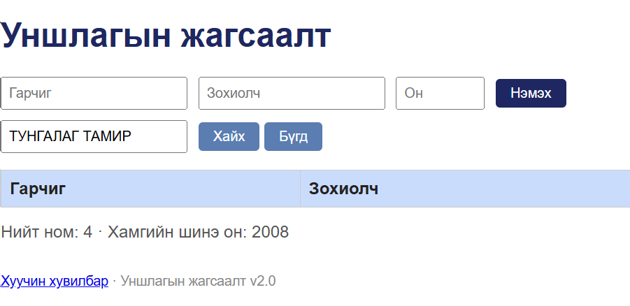

# BUG-02: Хайлт том/жижиг үсгийг ялгаж байна: жижиг эсвэл том үсгээр хайхад ном олдохгүй

Орчин:  Уншлагын жагсаалт v2.0, {{http://localhost:3000}}, Ubuntu (WSL2), 2026-10-16

Урьдчилсан нөхцөл: node app.js-ийг шинээр асаасан (анхны 3 ном)

## Дахин гаргах алхам

1. http://localhost:3000 хуудсыг нээнэ.
2. Ном нэмэх формд Гарчиг: `Alpha Book`, Зохиолч: `Beta Author`, Он: `2000` гэж бөглөж ном нэмнэ.
3. Хайлтын талбарт `Beta Author` (анх оруулсан хэлбэрээр) гэж бичиж хайна (шаардлагатай бол хайх товчийг дарна). Ном олдоно.
4. Хайлтын талбарыг цэвэрлээд `beta author` (бүгд жижиг үсгээр) гэж бичиж хайна.
5. Хайлтын талбарыг цэвэрлээд `alpha book` (гарчгийг жижиг үсгээр) гэж бичиж хайна.
6. Хайлтын талбарыг цэвэрлээд `ALPHA BOOK` (гарчгийг бүгд том үсгээр) гэж бичиж хайна.

Хүлээгдэж байсан: Спецификац «Хайлт гарчиг болон зохиолчоос хайх ба том/жижиг үсэг ялгахгүй» гэж заасан. 4-6 дахь алхам бүрд `Alpha Book` ном олдох ёстой.

Бодит үр дүн:     3 дахь алхамд ном олдоно. 4, 5, 6 дахь алхамд ном олдохгүй (илэрц хоосон). Зохиолч болон гарчиг хоёр дээр аль алинд нь согог гарна.

Ноцтой байдал: Major. Хайлт нь аппын гол функц бөгөөд хэрэглэгч үсгийн хэлбэрийг таах шаардлагатай болж байна. Спецификацийн дүрэм зөрчигдөж байна.

Хавсралт:      

Олдсон аялал:  Fed-Ex (өгөгдлийн зам)