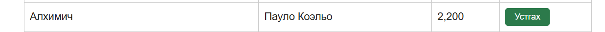
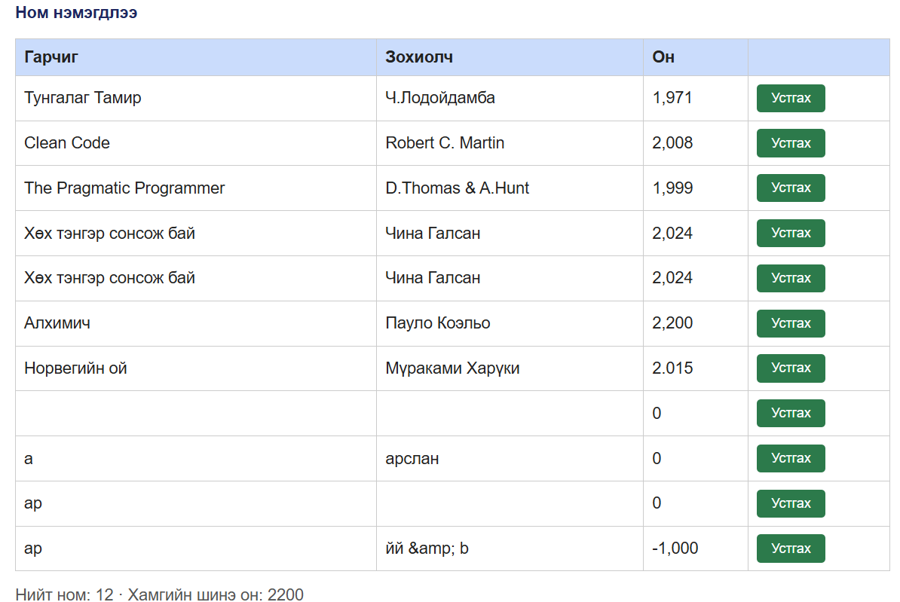
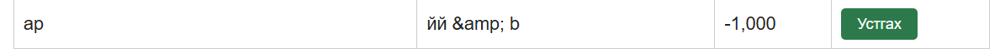

# BUG-03: Он талбарт 2100-аас дээш, бутархай, сөрөг утга алдаагүй хүлээн авч ном нэмж байна

Орчин:  Уншлагын жагсаалт v2.0, Google Chrome 155.0.8059.80, Ubuntu WSL2 (Windows), 2026-10-16

Урьдчилсан нөхцөл: node app.js-ийг шинээр асаасан (анхны 3 ном)

## Дахин гаргах алхам

1. Браузераар `http://localhost:3000` хаягаар орно.
2. Гарчиг: `Алхимич`, Зохиолч: `Пауло Коэльо`, Он: `2200` гэж бөглөж «Нэмэх» товчийг дарна.
3. Гарчиг: `Норвегийн ой`, Зохиолч: `Мураками Харуки`, Он: `2.015` гэж бөглөж «Нэмэх» товчийг дарна.
4. Гарчиг: `Тест`, Зохиолч: `Тест`, Он: `-1000` гэж бөглөж «Нэмэх» товчийг дарна.
5. Хүснэгтийг харна.

Хүлээгдэж байсан: Спецификац «Он нь 1000-2100 хоорондох бүхэл тоо» гэж заасан. 2200 (хүрээнээс гадуур), 2.015 (бүхэл биш), -1000 (хүрээнээс гадуур) гурвуулаа татгалзагдаж, ном нэмэгдэхгүй, ойлгомжтой алдааны мессеж гарах ёстой.

Бодит үр дүн:     Ямар ч алдааны мессежгүйгээр гурван ном бүгд хүснэгтэд нэмэгдэж, оныг нь `2,200`, `2.015`, `-1,000` гэж харуулна.

Ноцтой байдал: Major. Оролтын баталгаажуулалт байхгүй тул утгагүй өгөгдөл хадгалагдаж байна. Шалтгаан нь нэг (оны хүрээ ба төрлийн шалгалт дутуу) тул гурван тохиолдлыг нэг согог болгон нэгтгэв.

Хавсралт:

Олдсон аялал:  Supermodel (GUI, хэвийн бус утга)