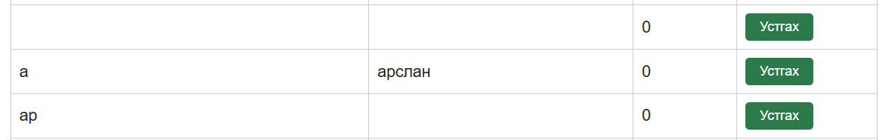

# BUG-04: Он эсвэл Зохиолч талбарыг хоосон орхиход ном алдаагүй нэмэгдэж байна

Орчин:  Уншлагын жагсаалт v2.0, {{http://localhost:3000}}, Ubuntu (WSL2), 2026-10-16

Урьдчилсан нөхцөл: node app.js-ийг шинээр асаасан (анхны 3 ном)

## Дахин гаргах алхам

1. http://localhost:3000 хуудсыг нээнэ.
2. Гарчиг: `Хоосон он`, Зохиолч: `Тест зохиолч` гэж бөглөж, Он талбарыг ХООСОН орхиод ном нэмнэ.
3. Гарчиг: `Хоосон зохиолч`, Он: `2000` гэж бөглөж, Зохиолч талбарыг ХООСОН орхиод ном нэмнэ.
4. Хүснэгтийг харна.

Хүлээгдэж байсан: Спецификац «Ном нэмэхэд Гарчиг, Зохиолч, Он гурван талбар бүгд заавал бөглөгдсөн байх ёстой; дутуу бол ном нэмэгдэхгүй, ойлгомжтой алдааны мессеж харагдана» гэж заасан. 2, 3 дахь алхам бүрд ном нэмэгдэхгүй, алдааны мессеж гарах ёстой.

Бодит үр дүн:     Хоёр тохиолдолд сануулга, алдааны мессежгүйгээр ном хүснэгтэд нэмэгдэнэ.

Ноцтой байдал: Major. Заавал бөглөх дүрэм мөрдөгдөхгүй тул дутуу мэдээлэлтэй ном бүртгэгдэж байна. Шалтгаан нь нэг (заавал бөглөх шалгалт дутуу) тул хоёр тохиолдлыг нэг согог болгон нэгтгэв.

Хавсралт:      

Олдсон аялал:  Couch Potato (хоосон оролт)