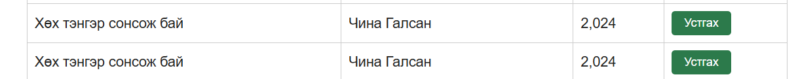

# BUG-06: Ижил Гарчиг, Зохиолчтой номыг дахин нэмэхэд татгалзалгүй давхардуулж нэмж байна

Орчин:  Уншлагын жагсаалт v2.0, Google Chrome 155.0.8059.80, Ubuntu WSL2 (Windows), 2026-10-16

Урьдчилсан нөхцөл: node app.js-ийг шинээр асаасан (анхны 3 ном)

## Дахин гаргах алхам

1. Браузераар `http://localhost:3000` хаягаар орно.
2. Гарчиг: `Хөх тэнгэр сонсож бай`, Зохиолч: `Чина Галсан`, Он: `2024` гэж бөглөж «Нэмэх» товчийг дарна. Ном нэмэгдэнэ (нийт 4 ном).
3. Яг ижил утгаар (Гарчиг: `Хөх тэнгэр сонсож бай`, Зохиолч: `Чина Галсан`, Он: `2024`) «Нэмэх» товчийг дахин дарна.
4. Хүснэгтийг харна.

Хүлээгдэж байсан: Спецификац «Ижил гарчиг, зохиолчтой ном давхардуулж нэмэгдэхгүй» гэж заасан. Хоёр дахь удаа ном нэмэгдэхгүй, ойлгомжтой мессеж гарах ёстой.

Бодит үр дүн:     Анхааруулах мессежгүйгээр ижил ном хоёр дахь удаа нэмэгдэж, хүснэгтэд ижил хоёр мөр харагдана.

Ноцтой байдал: Major. Спецификацийн дүрэм тодорхой зөрчигдөж, өгөгдөл хуулбарлагдаж байна.

Хавсралт:      

Олдсон аялал:  Supermodel (GUI)