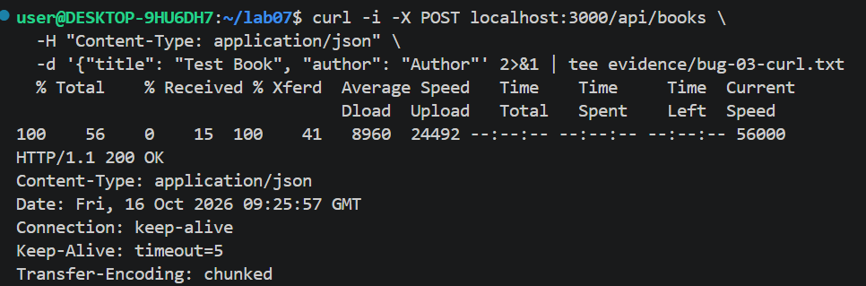

# BUG-06: Ном нэмэх формд ижил Гарчиг, Зохиолчтой номыг дахин нэмэхэд татгалзалгүй давхардуулж нэмж байна

Орчин:  Уншлагын жагсаалт v2.0, {{http://localhost:3000}}, Ubuntu (WSL2), 2026-10-16

Урьдчилсан нөхцөл: node app.js-ийг шинээр асаасан (анхны 3 ном)

## Дахин гаргах алхам

1. http://localhost:3000 хуудсыг нээнэ.
2. Ном нэмэх формд Гарчиг: `Тест ном`, Зохиолч: `Тест зохиолч`, Он: `2000` гэж бөглөж ном нэмнэ. Ном хүснэгтэд нэмэгдэнэ (нийт 4 ном).
3. Яг ижил утгаар (Гарчиг: `Тест ном`, Зохиолч: `Тест зохиолч`, Он: `2000`) ном дахин нэмнэ.
4. Хүснэгтийг харна.

Хүлээгдэж байсан: Спецификац «Ижил гарчиг, зохиолчтой ном давхардуулж нэмэгдэхгүй» гэж заасан. Тиймээс хоёр дахь удаа ном нэмэгдэхгүй, ойлгомжтой мессеж гарах ёстой.

Бодит үр дүн:     Анхааруулах мессежгүйгээр ижил ном хүснэгтэд хоёр дахь удаа нэмэгдэж, хүснэгтэд ижил хоёр мөр харагдана.

Ноцтой байдал: Major. Спецификацийн дүрэм тодорхой зөрчигдөж, өгөгдөл буруу хуулбарлагдаж байна. Гэхдээ апп ажиллагаагаа зогсоохгүй.

Хавсралт:      

Олдсон аялал:  Fed-Ex (өгөгдлийн зам)